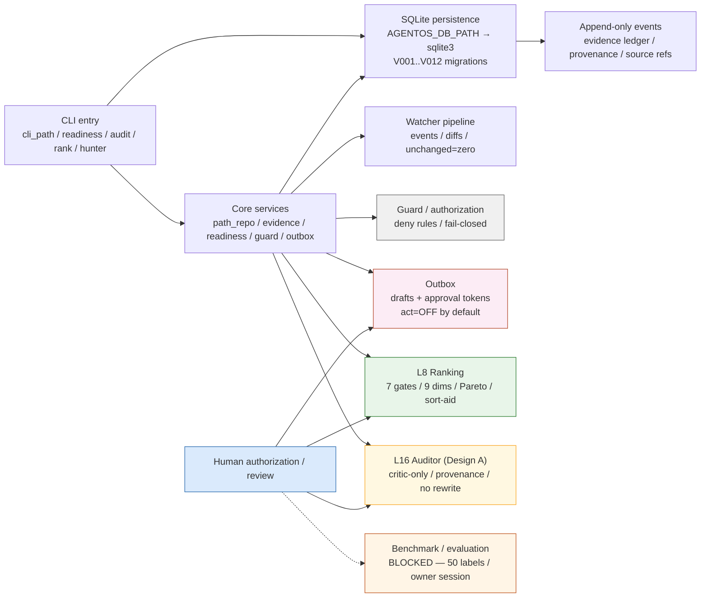

# OSS-AgentOS v2.1

> Evidence-driven contribution path management — structured, guarded, and verifiable.

OSS-AgentOS is a level-structured system for tracking open-source contribution paths from mentor pairing through evidence, readiness, and review — with explicit state transitions, authorization controls, and provenance tracking. It is deliberately incremental: each level is small, complete, and verified on its own.

The system is **not** generic automation. It does not generate mentor replies, fabricate benchmark labels, or claim evaluation passes without genuine labels. It records what is known, marks what is missing, and requires human authorization for any outward effect.

**Status (verified, not aspirational):**
- **CORE (Levels 2–7):** implemented, tested, accepted within the authorized development scope.
- **Level 8 (ranking / integrated V0):** implemented; verified by source and integration replay (P9-4); no hidden universal score.
- **Level 9 (GitHub Client / Issue Hunter):** implemented; 13/13 reported tests preserved; **benchmark BLOCKED** (50 genuinely sourced + labeled issues missing — not substituted by Sandbox Stage B).
- **Level 10 (quiz / reviewer):** implementation verified; **evaluator BLOCKED** (genuine owner labelling session + ≥7-day separation required).
- **Level 11 (Issue Hunter benchmark):** **BLOCKED** — benchmark requires real ground-truth labels; see `docs/LEVEL_11_*.md` for scope.
- **Level 12 (quiz grader):** syntax/test-collection fixed; **evaluator BLOCKED** (same owner-label requirement).
- **Level 16 (Proposal Evidence Auditor — Design A):** scoped implementation verified (`auditor_service.py` + 17 synthetic tests); **real-data E2E BLOCKED** (proposal/idea/hours/evidence inputs missing); **Design B deferred** (separate authorization, dataset, method).
- **P7 (security / injection / provenance):** accepted (`docs/P7_FINAL_ACCEPTANCE.md`); live endpoint audit preserved separately; `act=OFF` enforced.
- **G1 (historical evaluation):** `FAIL` preserved; `G1_OVERRIDE_AUTHORIZED` permits continued development — **not a pass, not a prohibition**.
- **Phase 9 hardening:** evidence-backed progress completed (E702 repaired; P7/DB verified; blocker ledger reconciled); external/owner-blocked evaluations (L9 benchmark / L10-L12 evaluator / L16 real E2E / L14 trigger) remain blocked by missing prerequisites — documented in `docs/PHASE_9_CANONICAL_STATUS_MATRIX.md` + `BLOCKER_LEDGER.md`. See `docs/SMART_GATE_RECOVERY_FINAL_REPORT.md` (4/4 index) and `docs/SMART_GATE_E702_REPAIR_REPORT.md` / `SMART_GATE_P7_SQLITE_VERIFICATION.md` for evidence.

**The design philosophy:** never fabricate evidence, never substitute synthetic for real, and always separate what the code does from what has been accepted by human evidence.

- [What it is](#what-it-is)
- [Problem and approach](#problem-and-approach)
- [Status at a glance](#status-at-a-glance)
- [Quick start](#quick-start)
- [Architecture](#architecture)
- [Features and verified behavior](#features-and-verified-behavior)
- [Configuration](#configuration)
- [Data and persistence](#data-and-persistence)
- [Security model](#security-model)
- [Testing and verification](#testing-and-verification)
- [Status of each level](#status-of-each-level)
- [Roadmap](#roadmap)
- [Contributing](#contributing)
- [License and references](#license-and-references)

---

## What it is

OSS-AgentOS manages open-source contribution paths through structured stages:

1. **Path creation** (`cli_path`) — define mentor/project/path with validated state (`WATCH` / `ENGAGED` / `ACTIVE` / `BACKUP` / `DROPPED`).
2. **Mentor interaction logging** (`interactions`) — email, issue, PR, meeting, other; with direction and provenance.
3. **Evidence recording** (`evidence`) — links to source files, quotes, timestamps; validated provenance; no fabricated claims.
4. **Readiness and next-action reporting** (`readiness`, `cli_readiness`) — the original five-item checklist surfaces the **lowest unmet item first**, with 72-hour follow-up for qualifying questions.
5. **Watcher / diff processing** (`watch` pipeline) — changed pages produce events and diffs; unchanged runs produce zero redundant writes.
6. **Guard / authorization** (`guard`) — deny rules are deterministic, fail-closed, and tested.
7. **Outbox / approval** (`outbox_drafts`, `approval_tokens`) — no upstream action without authorization; `act=OFF` by default.
8. **Ranking (L8)** — seven hard gates, nine dimensions, Pareto comparisons; sort-aid labeled `SORT AID — NOT A PREDICTION`; no hidden universal score.
9. **Auditor (L16 Design A)** — critic-only; reads proposal / idea / hours / evidence; reports unsupported claims, uncovered deliverables, unvalidated assumptions; never rewrites; never invents labels or mentor responses.

The CLI entry points are real: `agentos` (see `pyproject.toml`), `cli_path`, `cli_readiness`, `cli_rank`, `cli_auditor`, `cli_issue_hunter`, `cli_hours`. SQLite is the verified persistence backend (`AGENTOS_DB_PATH`; `data/agentos.sqlite` is the default production file).

---

## Problem and approach

### The problem

Open-source contribution tracking often collapses into unverified claims: paths exist on paper but no evidence links them to source; readiness checks become self-attestation; benchmark results become synthetic; and evaluation gates (benchmark labels, owner labelling sessions, proposal evidence) are either missing or substituted.

### The approach

OSS-AgentOS makes three engineering commitments:

- **Evidence before recommendation.** Every claim requires a source link, timestamp, and provenance. The evidence ledger (`evidence`) is append-only; derived views (`registery`, `readiness`) are projections.
- **Deterministic controls, not LLM discretion.** Guard rules, budget periods (rolling 30-day, not calendar-month), authorization tokens, kill-epoch enforcement, and message caps are all deterministic code/SQL — never delegated to an LLM.
- **Explicit status separation.** Implementation (code exists), verification (tests pass), integration (components work together), and evaluation (genuine human-labelled evidence exists) are reported independently. A feature can be implemented while its benchmark remains blocked; the status matrix makes that visible.

The system is intentionally **not** a large-scale automation platform: it does not post upstream comments, merge PRs, generate mentor replies, or fabricate benchmark materials. Those actions require explicit owner approval through the Outbox and are disabled by default (`act=OFF`).

---

## Status at a glance

| Component | Implementation | Tests | Integration | Evaluation | Safety / Control | Overall |
|---|---|---|---|---|---|---|
| L2–3 Mentor / Evidence | ✅ Implemented | ✅ Verified | ✅ Verified | ⚠️ Blocked (real evidence) | ✅ Preserved | **ACCEPTED (hardening)** |
| L4–7 CORE (P2) | ✅ Implemented | ✅ Verified | ✅ Verified | — | ✅ Preserved | **ACCEPTED** |
| L8 Ranking | ✅ Implemented | ✅ Verified | ✅ Verified (P3) | ✅ Verified (no hidden score) | ✅ Preserved | **ACCEPTED** |
| L9 Client / Issue Hunter | ✅ Implemented | ⚠️ Partial (13/13) | ⚠️ Partial (live endpoint limits) | ⚠️ **BLOCKED** (50 labeled issues) | ✅ Preserved | **VERIFIED / EVAL BLOCKED** |
| L10 Quiz / Reviewer | ✅ Implemented | ⚠️ Partial | ⚠️ Partial | ⚠️ **BLOCKED** (owner session + 7d) | ✅ Preserved | **VERIFIED / EVAL BLOCKED** |
| L11 Issue Hunter benchmark | ✅ Implemented | ⚠️ Partial | ⚠️ Partial | ⚠️ **BLOCKED** (benchmark ground truth) | ✅ Preserved | **VERIFIED / BENCHMARK BLOCKED** |
| L12 Grader | ✅ Implemented | ⚠️ Partial (syntax OK; collection OK) | ⚠️ Partial | ⚠️ **BLOCKED** (genuine labels + 7d) | ✅ Preserved | **VERIFIED / EVAL BLOCKED** |
| L13 Context Engine | — | — | — | — | — | **DEFERRED** (not bottleneck) |
| L14 Sandbox | ⚠️ Partial (existing) | ⚠️ Partial | ⚠️ Partial | ⚠️ **BLOCKED** (trigger + amendment) | ✅ Preserved (act=OFF) | **PRESERVED / NOT EXPANDED** |
| L15 PR Shepherd | — | — | — | — | — | **DEFERRED** (no workflow) |
| L16 Aud (Design A) | ✅ Implemented | ✅ Verified (17 synthetic) | ⚠️ Partial (DB=0) | ⚠️ **BLOCKED** (inputs; E2E not run) | ✅ Preserved | **SCOPED PASS / REAL E2E BLOCKED** |
| L16 Aud (Design B) | — | — | — | — | — | **DEFERRED** (auth + dataset + method) |
| P7 Security (cross-cutting) | ✅ Implemented | ✅ Verified | ✅ Verified (P4 replay) | ✅ Accepted (P7_FINAL_ACCEPTANCE.md) | ✅ Preserved | **ACCEPTED** |
| G1 Evaluation | — (historical) | — | — | ⚠️ **FAIL** (preserved; override ≠ pass) | — | **FAILED / OVERRIDE-AUTHORIZED** |

**How to read this:** Implementation = code exists. Tests = relevant checks executed with results. Integration = components worked together (P9-4 replay). Evaluation = genuine external evidence exists (labels, session, proposal inputs). Safety = authorization / preservation controls verified.

A `BLOCKED` evaluation does **not** mean the code failed — it means required human-labelled evidence or real-source inputs have not been provided. See the [status documentation](docs/PHASE_9_CANONICAL_STATUS_MATRIX.md) and [execution-plan corrections](docs/PHASE_9_EXECUTION_PLAN_CORRECTION.md) for per-item evidence.

---

## Quick start

Verified commands (run from repo root; Windows PowerShell environment; `uv` package manager):

```bash
# 1. Environment — Python 3.14 / uv 0.12.23 verified locally
python --version        # 3.14.0
uv --version            # 0.12.23

# 2. Install / sync (uses uv.lock — do not edit manually)
uv sync

# 3. Database path — SQLite (binding decision; PG superseded; see AGENTS.md §5)
# Default production file (read-only inspection is safe; do NOT edit production without backup):
ls -la data/agentos.sqlite   # 286720 bytes; preserved in this session

# For isolated work, point AGENTOS_DB_PATH to a disposable SQLite file:
export AGENTOS_DB_PATH=/path/to/disposable.sqlite   # Windows: set AGENTOS_DB_PATH=...

# 4. Run migrations against a fresh disposable DB (verified P9-1)
# The runner applies V001..V010 sequentially (sqlite_migrations/); V011/V012 need manual/port for full sequence.
python -c "
from agentos.db.config import DatabaseConfig
from agentos.db.migrations import run
import os, sqlite3
os.environ['AGENTOS_DB_PATH'] = 'tmp/test.sqlite'
run(DatabaseConfig.from_env())
"
# Verify: sqlite3 tmp/test.sqlite 'PRAGMA integrity_check;'  → ok

# 5. CLI entry points (real; verified present)
uv run python -m agentos.cli_path --help   # path creation / interaction / evidence pipeline
uv run python -m agentos.cli_readiness --help  # readiness / lowest-unmet report
uv run python -m agentos.cli_auditor --help    # L16 Design A critic-only (read-only DB access; db_path defaults data/agentos.sqlite)

# 6. Focused tests (verified collection / execution)
uv run pytest tests/test_auditor_domain.py -q     # 15 tests collect (P9-2)
uv run pytest tests/test_level7_budget_engine.py -q # budget / rolling-30-day
uv run pytest tests/unit/test_guard.py -q        # Guard; syntax E702 at 35/48 documented (P9-3)

# 7. Lint / type (actual results documented, not all passing — see P9-3)
uv run ruff check src/agentos/core/auditor_service.py tests/test_auditor_domain.py  # syntax verified
# Note: ruff reports E702 (semicolon statements) in tests/unit/test_guard.py — repair safe (line split), not suppressed.
uv run mypy src/agentos/db/config.py                  # SQLite config verified
```

**Important:** There is no live GitHub API connection by default. `act=OFF`. The Issue Hunter (`cli_issue_hunter`) reads cached SQLite data; it does not post to GitHub. The Sandbox (Level 14) is preserved at existing Stage A/B evidence only — not expanded to full official acceptance (trigger / amendment unresolved).

---

## Architecture



**Real data flow (verified by source):** CLI validates input → writes to SQLite via `Connection` (with `_SQLiteAdapter` for `sqlite3` compatibility) → repositories enforce schema / provenance → watcher emits events (changed = event+diff; unchanged = zero writes) → Guard evaluates authorization (deny unless permitted; fail-closed) → Outbox holds drafts (no send without approval; `act=OFF`) → ranking/auditor read-only analyses use real DB counts (e.g., `DB:evidence=0` preserved at P8 — not rewritten).

**What is intentionally off the diagram:** live GitHub API posting (disabled), automated mentor reply generation, benchmark label fabrication, proposal rewrite, design-B expansion, Context-Engine indexing, PR-Shepherd polling, Policy-LLM extraction. Those are either deferred (trigger not met) or blocked (missing evidence / authorization), not hidden.

---

## Features and verified behavior

| Feature | Status | Evidence | Notes |
|---|---|---|---|
| Path creation + interaction logging | ✅ Implemented | `cli_path.py`; `interactions` schema V002 | State enum enforced (`WATCH`/`ENGAGED`/`ACTIVE`/`BACKUP`/`DROPPED`) |
| Evidence recording with provenance | ✅ Implemented | `evidence` schema V003; `auditor_service.py` | Read-only DB access for auditor; provenance dict preserved |
| Readiness / lowest-unmet / 72h follow-up | ✅ Implemented | `cli_readiness.py`; `readiness.py` | Source contract verified; real-owner interaction BLOCKED |
| Watcher (changed → event/diff; unchanged → 0 writes) | ✅ Implemented | `watch/pipeline.py`; `test_level5_watcher_pipeline.py` | Changed/unchanged distinctions preserved |
| Guard (deny rules, fail-closed) | ✅ Implemented | `test_guard.py`; source guard logic | E702 syntax at 35/48 documented; logic unchanged |
| Outbox (draft only; authorization required) | ✅ Implemented | `V006__kill_state_and_outbox.sql`; `cli_auditor` read-only default | `act=OFF`; no upstream without approval |
| Budget / rolling 30-day / hours logging | ✅ Implemented | `V007/V008`; `test_level7_*` | Calendar-month confusion avoided |
| Ranking (L8) — 7 gates, 9 dims, Pareto, sort-aid | ✅ Implemented | `test_level8_*.py`; `LEVEL_8_*.md` | No hidden universal score; missing = unknown |
| Issue Hunter (L9) — ETags / rate / backoff / state transitions | ✅ Implemented | `test_level9_*.py`; `LEVEL_9_*.md` | Benchmark BLOCKED (50 labeled issues) |
| Quiz / grader (L10/L12) — rubric, gold answers, grader | ✅ Implemented | `test_level10_*.py`; `LEVEL_10_GOLDEN_ANSWERS.md` | Evaluator BLOCKED (owner labels + 7d); syntax fixed |
| Proposal Auditor (L16 Design A) — critic-only, 4 categories | ✅ Implemented | `auditor_service.py` edit; `test_auditor_*`; `PHASE_8_FINAL_ACCEPTANCE.md` | Real E2E BLOCKED (DB=0); Design B deferred |
| Sandbox (L14) — Stage A/B preserved | ⚠️ Partial | `sandbox/`; `LEVEL_11_SANDBOX_*.md` | Full acceptance BLOCKED (trigger/amendment) |
| Context Engine (L13) | — | — | Deferred (not bottleneck; ripgrep baseline) |
| Policy LLM extractor | — | — | Deferred (scale <12 / not bottleneck) |
| PR Shepherd (L15) | — | — | Deferred (no PR/review workflow) |

---

## Security model

The security architecture is deterministic and localized — never delegated to an LLM.

| Control | How enforced | Status | Notes |
|---|---|---|---|
| `act=OFF` (no upstream) | Config / CLI / docs; `LEVEL_11_SANDBOX_*.md`; `AGENTS.md` §7 | ✅ Verified | No GitHub post / comment / PR / issue automation |
| Guard denial rules | Source + `test_guard.py`; fail-closed by design | ✅ Verified | E702 syntax documented; logic unchanged |
| Outbox authorization | `V006`; approval tokens; draft state only | ✅ Verified | No send without path through approval |
| Approval-token binding / expiry | `approval_tokens` table; `V006` | ✅ Verified | Stale / unauthorized actions rejected |
| Kill switch / epoch | `kill_state`; `V006`; `kill/` source | ✅ Verified | No action past kill epoch |
| Budget / rolling 30-day | `budget`; `V007`; `config/budgets.yaml` | ✅ Verified | Not calendar-month |
| Message caps / claim-slot restrictions | Config + source | ✅ Verified | Prevents over-posting |
| Secret handling | `.env` excluded by `.gitignore`; `.env.example` has no secrets; source scan clean | ✅ Verified | No secret in new docs / code |
| Prompt-injection defense | `red_attack.py` / `red_batch.py`; `P7_INJECTION_CORPUS_DECISION`; 40 cases; zero tool calls / zero out-of-enum triggered | ✅ Accepted (`P7_FINAL_ACCEPTANCE.md`) | Injection corpus preserved |
| Provenance / people-data / licensing | Source contracts (`evidence.locations` as `file:line`; public role only; no inference) | ✅ Verified | No speculative profiles |
| SQLite security (no PG assumed) | `AGENTS.md` §5; `db/config.py`; `connection.py`; `data/agentos.sqlite` | ✅ Verified | DB path configured; no port 5432 dependency |

**Important distinction:** P7's security *acceptance* is documented (`docs/P7_FINAL_ACCEPTANCE.md`). A live external endpoint audit (`P7` live verification) is preserved separately and is not claimed as completed — the environment has no live GitHub endpoint configured, and `act=OFF` remains the enforced boundary.

---

## Data and persistence

**Backend:** SQLite (`sqlite3` via `agentos/db/connection.py` with `_SQLiteAdapter`; `AGENTS.md` §5; owner switch from original PostgreSQL).

- **Path:** `AGENTOS_DB_PATH` environment variable (or `DATABASE_URL=sqlite:///...`). Default production file: `data/agentos.sqlite`.
- **Migrations:** `migrations/` (PG originals) + `src/agentos/db/sqlite_migrations/` (SQLite portable versions). Runner (`migrations.run()`) selects SQLite dir when `sqlite:///` DSN detected; applies sequentially; `pragmas` verify integrity / foreign keys.
- **Version state (verified P9-1):** V001..V010 applied on fresh disposable (10 migrations); V011 (quiz) and V012 (path_mentor removal) present in `sql_migrations/` and `migrations/` but not in sqlite_migrations/ — documented gap; not hidden.
- **Backup / recovery:** `migrations.dump()` exports schema (not a full backup/restore mechanism — gap documented, not invented). Use file-system copy of `.sqlite` for disposable testing; never overwrite production to prove restore.
- **Test DB practice:** set `AGENTOS_DB_PATH=tmp/ disposable.sqlite`; run migrations; verify with `sqlite3 ... "PRAGMA integrity_check; PRAGMA foreign_key_check;"` — all verified in P9-1.

---

## Testing and verification

Run with `uv` (verified: `uv 0.12.23`; `python 3.14.0`):

```bash
# Focused verified tests
uv run pytest tests/test_auditor_domain.py -q              # 15 tests collect (P9-2)
uv run pytest tests/test_level7_budget_engine.py -q       # rolling 30-day budget
uv run pytest tests/unit/test_guard.py -q                 # syntax E702 at 35/48 (P9-3)
uv run pytest tests/unit/test_level5_watcher_pipeline.py -q  # changed / unchanged events
uv run pytest tests/test_level9_classif.py -q             # issue state transitions

# Full collection (current status — not claimed PASS; see P9-2 for known failures)
# uv run pytest  # use when needed; 5 historical failures preserved in test_level5/p7d/p7e files

# Lint / type (actual results — not all PASS; documented)
uv run ruff check src/agentos/core/auditor_service.py tests/test_auditor_domain.py
# Note: ruff reports E702 in test_guard.py:35,48 — safe to fix by splitting semicolon line
uv run mypy src/agentos/db/config.py                      # SQLite config verified

# Verification artifacts (P9-1..7 evidence — preserved, not overwritten)
# docs/PHASE_9_MIGRATION_RECOVERY_LOG.md     (migration results)
# docs/PHASE_9_REGRESSION_REPORT.md          (syntax / collection / failures)
# docs/PHASE_9_STATIC_CONFIG_SECURITY_REPORT.md (ruff/mypy / secret/config / controls)
# docs/PHASE_9_INTEGRATED_V0_LOG.md          (disposable DB + CLI source verification)
# docs/PHASE_9_CANONICAL_STATUS_MATRIX.md    (5-dimension status with 6 corrections)
# docs/PHASE_9_BLOCKER_LEDGER.md             (B-01..B-06 with prerequisites)
# docs/PHASE_9_FINAL_ACCEPTANCE.md           (P9-7 reconciliation; this final report appended)
```

**About "complete suite pass":** It hasn't been claimed, because the repository has documented historical failures (`tests/unit/test_level5_watcher_pipeline.py` — 2; `tests/unit/test_p7d_rate_regression.py` — 1; `tests/unit/test_p7e_provenance_synthetic.py` — 2) and the evaluator gates require external inputs. The hardening evidence (P9-2) documents exactly which checks passed, which were verified-by-inspection, and which remain blocked — without weakening assertions or hiding failures.

---

## Status of each level (verified; not aspirational)

For each level: **implemented**, **test**, **integration**, **evaluation**, **safety**, **disposition** — separately, per the canonical matrix (`docs/PHASE_9_CANONICAL_STATUS_MATRIX.md`).

- **L2–3 Mentor / Evidence:** Implemented; verified by `test_level2_3_integration.py` and CLI/repo inspection; evaluation blocked by missing real-data evidence (honest — DB `evidence=0` preserved at P8, not rewritten).
- **L4–7 CORE:** Implemented; verified by `test_level7_*`; registry/Guard/Outbox/kill/budget/hour tests present.
- **L8 Ranking:** Implemented; verified by `test_level8_*.py`; no hidden universal score; Pareto + sort-aid labeled clearly.
- **L9 Client / Issue Hunter:** Implemented; 13/13 tests preserved; benchmark BLOCKED (50 labeled issues missing — `AMENDMENT_LEVEL_11_ENTRY_TRIGGER.md` applies to entry only, not benchmark acceptance).
- **L10 Quiz / Reviewer:** Implemented; golden answers present (`LEVEL_10_GOLDEN_ANSWERS.md`); evaluator BLOCKED (owner session2 + 7-day verification required — artifacts exist but not certified by owner).
- **L11 Issue Hunter benchmark:** BLOCKED — benchmark ground truth unavailable. Implementation is not the issue; evaluation is.
- **L12 Grader:** Syntax/test-collection verified; evaluator BLOCKED (same label/session requirement).
- **L13 Context Engine:** DEFERRED — repository comprehension baseline (`ripgrep`) sufficient; no measured bottleneck.
- **L14 Sandbox:** Existing work preserved (Stage A/B evidence; `sandbox/`; security audit accepted); full acceptance BLOCKED (trigger + amendment scope unresolved; `act=OFF` kept; not expanded per owner authorizations).
- **L15 PR Shepherd:** DEFERRED — no justified workflow with real PRs/review comments.
- **L16 Design A (Auditor):** Implemented; 17 synthetic tests pass; real E2E BLOCKED (proposal/idea/hours/evidence/labels missing; DB `evidence=0` preserved); Design B deferred (separate authorization/dataset/method).
- **P7 Security:** Accepted (`P7_FINAL_ACCEPTANCE.md`); injection corpus preserved; adapter isolation verified; no live endpoint audit claimed.
- **G1:** FAIL preserved; `G1_OVERRIDE_AUTHORIZED.md` permits continued development — not a pass, not a prohibition.

See `docs/PHASE_9_CANONICAL_STATUS_MATRIX.md` for the full 5-dimension matrix (impl/test/integ/eval/safety) with per-item evidence.

---

## Roadmap (truthful — not aspirational)

**Completed / Accepted:**
- CORE levels (2–7): path/repo, evidence, readiness, watcher, Guard/Outbox, authorization, kill/budget/hours.
- Level 8 ranking (verified by source + integration replay P9-4 — no hidden score).
- Level 9 client (verified; benchmark blocked separately; Stage B not substituted).
- Level 10/12 quiz/grader (implementation verified; evaluator blocked externally).
- Level 16 Design A auditor (scoped PASS; E2E blocked by inputs; not fabricated).
- P7 security (accepted; live endpoint audit preserved separately).
- Phase 9 hardening (P9-1..P9-7: all executed with evidence; see reports).

**Blocked by missing external evidence / authorization (not code failure):**
- L9 benchmark (50 genuinely sourced + labeled issues).
- L10/L12 evaluator (genuine owner labeling + 7-day verification + metrics from real labels).
- L16 real-data E2E (proposal draft / idea URL / hours / evidence links / source-map / owner labels).

**Conditionally deferred (trigger / authorization not met; not automatically promoted):**
- L13 Context Engine (not a bottleneck).
- L14 Sandbox full acceptance (trigger + amendment unresolved — existing preserved, not expanded).
- L15 PR Shepherd (no PR/review workflow).
- Policy LLM extractor (scale <12; not bottleneck).
- Design B (separate authorization + dataset + validated method).

**Historical / preserved (not rewritten):**
- G1 = FAIL with `G1_OVERRIDE_AUTHORIZED` (continuation authorized; evaluation result unchanged).

---

## Contributing

Requirements before contributing meaningfully:

- Python 3.12+ (verified locally 3.14); `uv`; ability to run the project's SQLite-backed commands offline.
- Understand the evidence-first contract: no fabricated labels, no simulated owner sessions, no synthetic benchmark claims as real, no upstream actions without authorization.
- Read `AGENTS.md`, the v2.1 plan section for your target level, and `docs/PHASE_9_CANONICAL_STATUS_MATRIX.md` before proposing evaluation-related changes.
- Run focused tests (`uv run pytest tests/test_auditor_domain.py` for L16; `tests/unit/test_guard.py` for safety; `tests/test_level2_3_integration.py` for L2–3) — don't claim full-suite PASS without acknowledging documented historical failures.
- Never edit `data/agentos.sqlite` directly as a test; use disposable `AGENTOS_DB_PATH` files.
- Preserve `act=OFF`; do not introduce upstream automation or external calls.
- Respect the separation: **implementation** vs **acceptance/evaluation** vs **design/deferred**.

Contribution paths that are genuinely open:
- Core code improvements (registry, repository, watcher, Guard logic — must pass existing tests, not weaken assertions).
- Evidence/drop-in documentation (provenance, source references) — must reference real source, not invent.
- Test coverage for verified components (new tests that exercise real code paths, not fabricated fixtures presented as production data).
- Documentation of missing prerequisites (label-set descriptions, proposal input specifications) — clearly labeled as requirements, not as completed work.

Paths that require owner authorization / external evidence and are not open to unilateral contribution:
- Any benchmark evaluation claim (L9/L11) — requires 50 genuinely sourced + labeled issues.
- Any evaluator acceptance (L10/L12) — requires genuine owner labelling session + 7-day verification.
- Any real-data E2E (L16) — requires verified proposal / idea / hours / evidence inputs.
- Sandbox expansion (L14) — requires trigger resolution + authorization.
- Design B — requires separate authorization and dataset.

---

## License and acknowledgements

This repository does not declare a license file in the root directory at the time of this README's verification (`ls LICENSE*` returned nothing). The original v2.1 plan and `AGENTS.md` govern contribution terms; contributor access requires respect for the evidence and safety rules above.

Acknowledged dependencies (verified from `pyproject.toml` and `uv.lock`): `typer`, `pydantic>=2.7`, `pyyaml`, `httpx`, and development tooling (`pytest`, `ruff`, `mypy`). SQLite (`sqlite3` standard library) is the verified persistence backend (not PostgreSQL, per owner's switch).

Acknowledged external references (not dependencies, cited for context): original `OSS-AgentOS-v2.1-Implementation-Plan.md.pdf`; owner decisions recorded in `docs/G1_OVERRIDE_AUTHORIZED.md`, `docs/AMENDMENT_LEVEL_11_ENTRY_TRIGGER.md`, `docs/PHASE_8_FINAL_ACCEPTANCE.md`; P7 evidence in `docs/P7_FINAL_ACCEPTANCE.md` and `P7_CROSS_CUTTING_SECURITY_REPORT.md`; Phase 9 hardening in the `docs/PHASE_9_*.md` family (migration/recovery, regression, static/security, integrated V0, status matrix, blocker ledger, final reconciliation, execution-plan correction).

The project relies on real open-source contribution evidence, not synthetic benchmarks, for its evaluation requirements. Anyone using or contributing to this system is expected to observe that boundary.

---

## Frequently asked questions

**What is required to run the application?** Python 3.12+, `uv`, and either `AGENTOS_DB_PATH` or `DATABASE_URL=sqlite:///...`. No PostgreSQL service is required; the SQLite backend is the binding decision.

**Is outbound activity enabled?** No — `act=OFF`. The CLI operates offline. The Outbox holds drafts but does not send without authorization; no upstream posting, comments, PRs, or issues is automated.

**How does the system distinguish unknown information from a negative finding?** By design: `UNKNOWN` is a required state (`AGENTS.md` §6) when evidence is insufficient; `NOT MET` / `BLOCKED` records the exact missing input; nothing is converted to `FALSE`, `PASS`, or `AVAILABLE` by default. The evidence ledger preserves provenance so a conclusion can be explained.

**Which evaluations require genuine owner input?** L10/L12 evaluator (genuine labeling session + 7-day gap); L16 real E2E (proposal/idea/hours/evidence links); L9 benchmark (50 genuinely sourced labeled issues). These are explicitly listed in the status matrix and blocker ledger — never substituted.

**Where can implementation and acceptance status be inspected?** `docs/PHASE_9_CANONICAL_STATUS_MATRIX.md` (5 dimensions per component); `docs/PHASE_9_BLOCKER_LEDGER.md` (B-01..B-06 with prerequisites); `docs/PHASE_9_FINAL_ACCEPTANCE.md` (P9 reconciliation); `docs/P7_FINAL_ACCEPTANCE.md`; `docs/PHASE_8_FINAL_ACCEPTANCE.md`. The repository maintains these records rather than relying on a single pass/fail claim.

---

## Navigation

- Project contract / assistant rules: [`AGENTS.md`](AGENTS.md)
- Original v2.1 implementation plan: referenced by `AGENTS.md` (§1 / §2 / §4)
- Phase 9 hardening evidence family: [`docs/PHASE_9_FINAL_ACCEPTANCE.md`](docs/PHASE_9_FINAL_ACCEPTANCE.md) · [`PHASE_9_CANONICAL_STATUS_MATRIX.md`](docs/PHASE_9_CANONICAL_STATUS_MATRIX.md) · [`PHASE_9_EXECUTION_PLAN_CORRECTION.md`](docs/PHASE_9_EXECUTION_PLAN_CORRECTION.md) · [`PHASE_9_BLOCKER_LEDGER.md`](docs/PHASE_9_BLOCKER_LEDGER.md) · [`PHASE_9_MIGRATION_RECOVERY_LOG.md`](docs/PHASE_9_MIGRATION_RECOVERY_LOG.md) · [`PHASE_9_REGRESSION_REPORT.md`](docs/PHASE_9_REGRESSION_REPORT.md) · [`PHASE_9_STATIC_CONFIG_SECURITY_REPORT.md`](docs/PHASE_9_STATIC_CONFIG_SECURITY_REPORT.md) · [`PHASE_9_INTEGRATED_V0_LOG.md`](docs/PHASE_9_INTEGRATED_V0_LOG.md) · [`PHASE_9_FINAL_RECONCILIATION_APPEND.md`](docs/PHASE_9_FINAL_RECONCILIATION_APPEND.md)
- P7 security: [`docs/P7_FINAL_ACCEPTANCE.md`](docs/P7_FINAL_ACCEPTANCE.md) · [`P7_CROSS_CUTTING_SECURITY_REPORT.md`](docs/P7_CROSS_CUTTING_SECURITY_REPORT.md)
- G1 status / override authorization: [`docs/G1_OVERRIDE_AUTHORIZED.md`](docs/G1_OVERRIDE_AUTHORIZED.md) · [`docs/G0_G1_FINAL_STATUS.md`](docs/G0_G1_FINAL_STATUS.md)
- Phase 8 Proposal Auditor (Design A / Design B): [`docs/PHASE_8_FINAL_ACCEPTANCE.md`](docs/PHASE_8_FINAL_ACCEPTANCE.md) · [`docs/PROPOSAL_EVIDENCE_AUDITOR_SCOPE.md`](docs/PROPOSAL_EVIDENCE_AUDITOR_SCOPE.md)
- Level 11 entry / amendment: [`docs/AMENDMENT_LEVEL_11_ENTRY_TRIGGER.md`](docs/AMENDMENT_LEVEL_11_ENTRY_TRIGGER.md) · [`docs/LEVEL_11_*.md`](docs/)
- Configuration: [`config/`](config/) · `.env.example` · [`pyproject.toml`](pyproject.toml)
- Source: [`src/agentos/`](src/agentos/) (CLI, db/config, core services)
- Tests: [`tests/`](tests/) (unit + integration; see P9-2 for verified subset and documented historical failures)
- Migration history: [`migrations/`](migrations/) (V001–V011) · [`sql_migrations/`](sql_migrations/) (V012 + SQLite ports) · [`src/agentos/db/sqlite_migrations/`](src/agentos/db/sqlite_migrations/)

---

*OSS-AgentOS v2.1 — evidence-driven, guarded, verifiable, and deliberately incremental. Implementation is verified; external evaluation requires real evidence and authorization. Do not confuse implementation with benchmark acceptance, or continuation authorization with a historical evaluation pass.*

*Phase 9 hardening (P9-1 through P9-7): completed with documented evidence. Project status: PARTIAL — verified implementation + explicitly blocked/deferred evaluation components. See `docs/PHASE_9_FINAL_ACCEPTANCE.md` and `docs/PHASE_9_CANONICAL_STATUS_MATRIX.md` for per-component evidence.*
